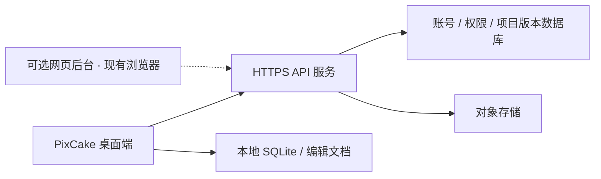

# 云平台后端建设计划

日期：2026-11-09
状态（2026-11-10）：B1a、B1b 账号逻辑及 B2 文件传输已实现。账号桌面闭环通过真实本地 TLS，文件同步通过真实后端的管道双目录集成及 HTTPS + renderd 验收。短信使用用户授权的可替换开发 mock；供应商与公网部署仍待完成，见[最新证据](../evidence/2026-11-10-cloud-auth-and-sync.md)。

## 平台组成

云空间需要可部署的服务端，不需要开发浏览器。桌面端直接调用 HTTPS API；网页管理后台是后续可选客户端，用户用现有浏览器打开即可。首个闭环以桌面端为入口。

| 部分 | 数据主人与职责 | 当前状态 |
| --- | --- | --- |
| 桌面本地项目 | `ProjectLibrary` / SQLite 保存本机项目索引；`EditDocument` 保存编辑参数 | 已有，继续本地优先 |
| 桌面云会话 | `CloudSession` 缓存当前账号可见空间与权限；`CloudService` 验证目录 | 已有基础；不是服务端身份或权限数据库 |
| 桌面协议适配 | 目录/账号 codec、固定来源 HTTPS、后台任务与分块同步 | 登录/注册、钥匙串适配、上传下载和恢复均已实现；文件 TLS 验收已通过 |
| 云 API 服务 | 验证身份与权限、个人/团队空间、项目版本和传输提交 | 账号、目录、分块提交/读取/清理、CAS 版本与幂等均已实现 |
| 服务端数据库 | 账号、成员关系、空间、项目、修订、文件引用与任务状态 | 独立 SQLite schema 3，包含凭证摘要、验证码、限流、版本与上传任务；显式迁移 1/2 |
| 文件存储 | 原图、参数、图层与生成像素的不可变分块 | 单机私密 `.objects` 目录已实现；生产对象存储/多实例方案待接 |
| 网页管理后台 | 账号/团队管理、容量和项目管理等后续入口 | 未实现，不作为首个桌面闭环的前置条件 |

当前采用独立 `backend/cloud` 单服务：Python 3.12、FastAPI/Uvicorn、SQLite，桌面仍为 C++；不预设微服务拆分。服务端运行时、数据库连接或管理凭证不得进入桌面 `kernel`。选型与锁定见[依赖记录](../evidence/2026-11-09-cloud-backend-dependencies.md)，接口见[后端 API v1](../specs/2026-11-09-cloud-backend-api.md)。客户端继续遵守[云空间契约](../specs/2026-11-09-cloud-space-contract.md)和[分阶段实现计划](2026-11-09-cloud-space.md)。

## B0：确认范围与冻结接口

- [x] 记录当前无后端；区分桌面、服务端和可选网站，消除“需要自建浏览器”的误解。
- [x] 服务端代码放 `backend/cloud`，独立锁文件/环境，默认只监听本机；不进入桌面构建与应用包。
- [x] 比较 HTTP/API、签名与存储候选，锁定直接和传递依赖/校验和/许可；本阶段采用单机 SQLite，不手写 HTTP、JSON 或密码学。
- [x] 明确保留既有短信登录设计；冻结 B1a 本地可信签发、服务端会话验证/到期/撤销规则，未提供假验证码或公开管理接口。
- [x] 写入 API 契约与 OpenAPI 快照，覆盖身份、空间/项目目录、错误码、字段限额、分页修订一致性与游标有效期。
- [x] 建立本地服务、管理命令和隔离测试账号，完成真实 HTTP 请求验证。
- [x] 公共注册/登录/重置/刷新/退出 API 与开发短信 SDK 端口，密码采用 Argon2id。
- [ ] 确定真实短信供应商、生产运行时/数据库/对象存储与部署配置。

完成标准：契约、依赖和运行说明可复现；客户端 codec 可依据真实样例实现，测试替身不能作为已部署服务。

## B1：账号与空间目录

### B1a：独立后端目录服务（本轮已完成）

- [x] 实现服务端会话验证、退出/失效处理，数据库仅保存令牌摘要；本地签发写私密文件，失败回滚，凭证不出现在日志与项目数据中。
- [x] 建立个人/团队空间与成员关系；服务器独立判定读、写、管理能力，客户端不能自报权限。
- [x] 实现有界分页的空间与项目目录查询；每页重新验证权限，相关目录修订变化拒绝继续旧分页。
- [x] 覆盖未登录、过期会话、账号隔离、团队撤权、跨空间访问、分页变动、超限输入、事务回滚、数据库误用与重启。
- [x] 补运行说明、依赖清单、OpenAPI 与[验收记录](../evidence/2026-11-09-cloud-backend-directory.md)。

### B1b：登录与桌面生产对接（开发闭环已完成，生产配置待接）

- [x] 随机验证码签发/验证、持久化限流、注册、密码与短信登录、重置、轮换刷新、会话族撤销；真实 SDK 只替换投递端口。
- [x] 用本项目 API v1 实现桌面 JSON codec；独立实现 macOS 系统 curl HTTP transport，不放宽 HTTPS、限额与超时要求。
- [x] 本地 TLS 联调 `CloudService -> HttpCloudGateway -> codec/transport -> 真实后端`，覆盖两个账号、分页、退出撤权、限额、错误映射、重定向禁用与整体超时，见[记录](../evidence/2026-11-10-cloud-desktop-https.md)。
- [x] 接入账号验证、后台请求编排及只读目录页面；[本地验收](../evidence/2026-11-10-cloud-browser.md)使用显式开发令牌，未开放产品令牌登录入口。
- [x] Qt 账号页面、开发验证码自动填入、后台请求、迟到响应隔离和钥匙串刷新凭证适配；真实本地 TLS 桌面注册/重新登录/重置/退出通过。
- [ ] 接入正式短信 SDK 并在生产候选部署环境验收。

完成标准：两个测试账号相互不可越权，桌面能列出真实目录；断网、未配置和服务端拒绝均显示真实失败。

## B2：项目版本与文件传输

- [x] CSY-01–08 与 API/OpenAPI 冻结清单和绑定规则；文件长度、SHA-256、文档版本与依赖有界，不携带本机访问凭证。
- [x] 1 MiB 分块、7 天未提交任务有效期、2 个并发整体验证、原子发布后可见的新修订。
- [x] 独立任务幂等键和基础修订条件提交；重复请求不重复创建版本，冲突保留双方。
- [x] 下载固定版本、逐请求读权限校验；桌面临时接收、摘要校验、命令入口事务导入和持久回执。
- [x] 幂等清理未提交分块、重启恢复、容量上限与撤权检查；已发布版本不会被清理任务删除。
- [x] 双目录管道集成验证真实后端：原图解码、参数/副本/图层恢复、断网、损坏块、回滚、幂等提交和版本冲突。
- [x] 完整 HTTPS + renderd 双目录脚本在提交前授权恢复后已执行通过。真实磁盘耗尽与生产备份恢复仍留待运行验收。

完成标准：版本与文件引用一致，失败保留上一个有效版本。实现/管道集成与真实 TLS/物理设备/生产部署分别记录，不相互代替。

## B3：运行保障与后续网站

- [ ] 记录部署、数据迁移、备份恢复、服务限流与资源上限；业务审计只记录必要标识和结果，不记录凭证或原图内容。
- [ ] 覆盖权限回归与备份恢复演练，记录测试环境、服务版本和客户端版本。
- [ ] 在桌面闭环通过后，按实际产品需求决定网页后台范围；复用同一 API 与权限体系，不另建一套权限真相。

当前已实现独立账号与文件服务、桌面登录注册和同步页面；未部署公网服务、创建云资源或选择付费供应商。后端 49 项测试通过；详细测试、部署和工具审批边界见本轮证据。
