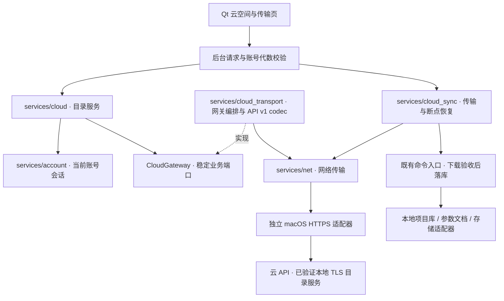

# 云空间模块实现计划

日期：2026-11-09
状态（2026-11-10）：目录、账号注册/短信与密码登录、会话恢复、快照和文件同步已实现。开发随机验证码可自动填入，密码使用 Argon2id；分块同步、断点恢复和冲突另存已通过真实后端的管道集成。真实 TLS 文件同步及 renderd 打开验证已通过；真实短信与公网部署尚待完成，详见[账号计划](2026-11-10-cloud-auth.md)、[文件同步计划](2026-11-10-cloud-file-sync.md)和[本轮证据](../evidence/2026-11-10-cloud-auth-and-sync.md)。

## 目标与约束

把云空间入口逐步接到可测试的目录、传输和本地项目接收流程。执行依据为[云空间目录契约](../specs/2026-11-09-cloud-space-contract.md)、[桌面需求](../specs/2026-11-02-pixcake-desktop-phase1-design.md)、[架构规范](../specs/2026-11-02-pixcake-kernel-architecture-design.md)和[第三方依赖规范](../specs/2026-11-06-pixcake-third-party-dependency-policy.md)。该能力为 PixCake-specific。

用户已授权按阶段开始实现；当前工作树存在其他模块改动，仅追加本模块文件和必要接线，不覆盖已有工作。沿用桌面分支 `codex/desktop-official-layout`。

- `kernel` 不依赖云服务、Qt、HTTP 或 JSON；不把云协同协议写进内核。
- 本地索引和修图文档继续由现有模块拥有；网关不直接改 SQLite 或原图。
- 真实 API、鉴权、对象存储和分页协议必须有文档/沙盒证据。测试替身只在测试中存在，不作为生产离线成功通道。
- 权限是服务端显式能力，不能根据个人/团队身份或名称猜测角色授权。
- 请求失败不关闭本地项目；收到成功确认前不更改本地云标识。
- `ProjectSnapshot` 已在 `services/project_session` 实现；线上的可移植清单与分块协议由 `services/cloud_sync` 拥有。

用户确认起步时尚无云后端，当前已实现独立账号/目录/分块服务。用户随后明确要求用可替换 mock SDK 完成验证码与账号闭环，并同时实现文件同步。平台需要 API 服务、服务端数据库和文件存储，不需要开发浏览器；网页管理后台属于后续可选入口。部署顺序见[云平台后端建设计划](2026-11-09-cloud-backend.md)。

## 阶段 1：目录与会话基础

### 1.1 冻结契约（CLD-01–08）

- [x] 写明数据主人、权限语义、错误码、资源上限和同步端口的线程限制。
- [x] 新增 `services/cloud` 目标和 `cloud_types.hpp`、`cloud_session.hpp`、`cloud_gateway.hpp`、`cloud_service.hpp`。
- [x] 本阶段只依赖 `pixcake_account`、`pixcake_support`，移除不使用的 `pixcake_net` 链接。

### 1.2 账号生命周期与响应验证

- [x] 为 `AccountSession` 补充内存 `generation()`，验证成功登录/缓存加载、显式退出与无效登录、偏好修改的区别；退出同时作废尚未完成的后台会话恢复。
- [x] `CloudSession` 引用活的账号服务，显式打开/关闭；登出及重新登录立即使旧目录不可见。
- [x] `CloudService` 在调用前后验证账号与目录代数，拒绝过时响应。
- [x] 完整校验目录，失败不部分替换；鉴权拒绝清空旧权限。
- [x] 使用已有 `LogSink` 输出事件与结果码，不记录会话句柄或远端正文。

### 1.3 测试与架构门禁

- [x] `tests/services/cloud/test_cloud_service.cpp` 使用 fake gateway 覆盖 CLD-01–07：成功、空目录、无权限、断网/取消、坏返回、上限、旧响应和日志。
- [x] `tests/services/account/test_account_session.cpp` 补充 `test_s25_authentication_generation`。
- [x] `tests/arch/check_cloud_dependencies.cmake` 接入已有 `architecture_gate`；禁止云层直接使用 Qt、SQLite、图像/渲染/平台/具体网络库。
- [x] `test_cloud_dependencies` 验证正样例和违规 include/链接的负样例。
- [x] 在 `build-cloud-space` 独立目录完成专门测试和账号/显示模型/命令入口/项目会话回归。
- [x] 更新[证据](../evidence/2026-11-09-cloud-space-foundation.md)，只标记实际执行通过的范围。

## 阶段 2：网关适配和网络契约

后端 B1a 已冻结[API v1](../specs/2026-11-09-cloud-backend-api.md)并完成本机 HTTP 验证；客户端 2A 编排框架已完成。2B 继续实现基于真实契约的 codec/transport，并与[后端计划 B1b](2026-11-09-cloud-backend.md)的登录与 HTTPS 沙盒联调。

### 2A：可注入网关编排（已完成）

- [x] 新增 `services/cloud_transport` 与 `CloudWireCodec`、`HttpCloudGateway`；依赖 cloud/net/support，保留目录服务的权限规则。
- [x] 在 `HttpRequest` 追加响应限额与重定向策略，兼容原有 `send` 方法；共享使用者做回归。
- [x] 实现空间/项目分页聚合、游标循环检测、整体超时预算、原始响应/累计条目上限和 HTTP 错误映射（CLD-09–13）。
- [x] 先写 fake clock/transport/codec 测试，验证第二页失败、最后一页迟到、401/403、坏解码和限制被传到 transport。
- [x] 测试贯穿 CloudService，验证旧目录保留、权限撤销、账号失效后的迟到结果和跨页坏数据。
- [x] 扩展依赖门禁及正负样例，补[阶段证据](../evidence/2026-11-09-cloud-http-gateway.md)与总盘点。

### 2B：真实后端适配

2B1（已完成）：

- [x] 固定 nlohmann/json 3.12.0 的头/许可证及校验和，只链接 macOS SDK 系统 curl；通过可选构建开关接入。
- [x] 实现 API v1 空间/项目 codec，独立 HTTPS transport；覆盖 JSON 坏包/资源边界、URL 来源和请求预检查，保持 cloud 服务纯依赖。
- [x] 临时 CA、本地真实后端与 C++ 服务链完成分页、身份隔离、退出撤权、证书/主机名、重定向、解压后限额和整体超时检查。
- [x] 10 项客户端/回归/架构检查、关闭 HTTP 的独立构建 4 项检查和后端 29 项测试通过；更新[证据](../evidence/2026-11-10-cloud-desktop-https.md)。

2B2（账号、后台请求及安全存储已实现，生产配置待接）：

- [x] 通过 `/v1/account` 获取账号 ID/到期时间，核对当前账号身份；身份与目录共享请求预算，不把 API 未返回的余额或订阅作为服务端结果。
- [x] 公共注册、短信/密码登录、重置、刷新、退出；开发短信随机码自动填入，后台客户端使用类型化协议。刷新凭证接入系统钥匙串，恢复须经服务器确认。
- [ ] 真实短信 SDK、完整账号权益接口、生产 HTTPS 域名及线上环境验收。
- [x] 壳层在 UI 线程之外执行请求，并串行提交会话状态、接入结果日志及用户提示；启用 HTTP 时应用包装入第三方许可。

目录与账号服务链已通过真实本地 TLS；开发短信投递不代表供应商接入，发布环境仍须独立验收。

## 阶段 3：本地绑定与上传快照

设计与实现见 CSY-01–06；绑定及任务日志位于账号与 HTTPS 来源专属目录，数据库保存导入回执。

- [x] 本地项目与远程空间/项目 ID、已确认修订、待传日志和错误状态；按账号隔离。
- [x] 不可变清单包含原图、已提交参数、副本、图层与生成像素；资源编号、长度和摘要有界，不上传凭证与本机路径。
- [x] 通过公开文档接口取得已提交数据，不包含拖动中的预览或整条撤销链。
- [x] 下载先写临时区、校验完整性与路径，再经命令入口事务提交本地索引；失败不修改已有项目。
- [x] schema 迁移、格式/路径验证、回滚、幂等导入及崩溃遗留文档恢复测试；真实磁盘耗尽注入留在生产候选验收。

完成标准：本地绑定和快照在关闭重开后可复核；失败保留上一份有效文档；只有成功确认才能标为已上传/已下载。

## 阶段 4：传输任务与恢复

- [x] 任务 ID、版本、随机任务 nonce 派生幂等键、进度、暂停、清理、错误与冲突状态。
- [x] 持久化清单、分块、开始/提交确认与清理意图；重启可继续，导入回执防止重复创建。
- [x] 单工作线程、有界分块、最多 3 次间隔 30 秒自动重试，之后手动继续。
- [x] 本项目后端真实支持分块续传、内容摘要、幂等提交和清理接口，OpenAPI 已更新。
- [x] 覆盖响应丢失、取消/换账号后的旧结果、断网、坏块和崩溃恢复；真实 TLS 文件传输也已补验通过，磁盘耗尽仍待额外验收。

完成标准：一项失败不回滚其他已完成项；重试不重复提交；进度仅来自真实任务。

## 阶段 5：修订冲突与团队能力

- [x] 基础修订比较与事务条件提交；并发改动返回冲突，保留已有版本。
- [x] 保留两份生成新云项目，下载生成新本地项目；参数自动合并不在当前规则内。
- [x] 团队成员由可信管理 CLI 维护；每个文件读写请求重新鉴权，本地缓存不作为最终授权。
- [x] 权限撤回、账号切换及过期令牌均不能授权新的传输请求。

## 阶段 6：壳层接入与端到端验收

- [x] 依据已有导航与个人/团队空间需求新增 PixCake 自身只读目录视图，沿用主题；不声称复刻未经核实的外部产品页面，见[本轮契约](2026-11-10-cloud-browser.md)。
- [x] `ui/shell` 统一文案、状态与页面导航，`apps/shell` 仅画控件，控制器编排服务。
- [x] 展示个人/团队空间、加载中、空列表、网络错误、未配置后端和权限不足；未配置不显示假项目或假上传成功。
- [x] 单活动传输显示真实进度、暂停/继续、冲突另存与清理；云标识只在服务器或本地导入确认后更新。
- [x] 跑目录页面、服务故障、账号切换与迟到响应测试；实际 TLS 页面联调和 Release 入口检查通过，已登记全仓源码规范检查的既有失败。
- [x] 双独立项目库经真实后端完成上传/下载，原图可解码、参数/副本/图层可恢复；断点、冲突与回滚通过。
- [x] 真实 TLS + renderd 文件同步闭环。提交前授权恢复后，在独立源码快照上执行通过；仍不把本机双目录测试称作另一台物理设备的验收。

完成标准：记录真实服务端测试范围，明确本地单测与线上能力的区别；更新总盘点，不把尚未执行的步骤勾成已完成。
