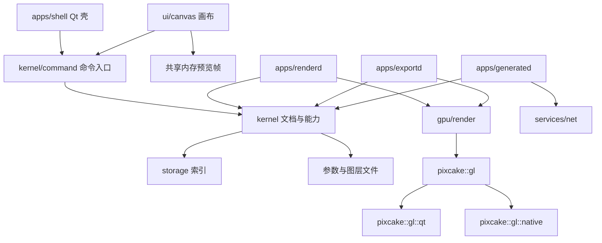

# 像素蛋糕桌面版架构设计规范

日期：2026-11-02  
状态：待审阅；Qt 6 Widgets 壳层决策已确认

桌面壳层工作必须在专用桌面分支进行，不得继续在 `kernel-project-library` 分支增加 `apps/shell`、`ui` 或 Qt 相关实现。新会话开始先检查 `git branch --show-current`；内核分支只允许内核和架构文档工作。当前桌面布局计划建议使用 `codex/desktop-official-layout`。
上位文档：[第一阶段需求](2026-11-02-pixcake-desktop-phase1-design.md)  
对照产品：`pixcake-test` 9.3.0（构建号 811）
全局依赖规则：[第三方依赖优先与引入规范](2026-11-06-pixcake-third-party-dependency-policy.md)

本文只规定目录、模块边界、依赖方向、精修能力怎么组合、OpenGL 怎么替换、失败时谁负责。滑杆名称、快捷键、扣点数字、验收步骤仍以上位文档为准。两边冲突时：用户能看见的行为以上位文档为准；代码放哪、谁可以 include 谁，以本文为准。像素蛋糕-test 标题旁的 Free 只是试用或额度标记，不构成范围排除：带这个标记的功能与其他功能一样在本阶段实现，行为以上位文档为准（2026-11-05 用户裁决）。

看不清的控件不靠猜测补齐。先在正在运行的像素蛋糕-test 上用 Jarvis 看当前画面，再查手册 [工作区页面介绍](https://www.pixcakeai.com/guide/32445)。该页更新日期是 2026 年 9 月 17 日，写的是登录、主页、精修、图库和创意的区域划分，不写滑杆上下限，也不解释 Free。滑杆刻度以 test 版上拖到两端、右侧数字跟着改变的读数为准。

本阶段不写实现。本文是开工前的结构合同。它故意覆盖整个桌面内核，让依赖规则只有一个出处。后面的实现计划按内核、GPU 后端、Qt 壳、导出与生成拆开，不在同一份计划里同时开工。

## 1. 产品在架构里的形状

像素蛋糕桌面版是本地优先的商业后期工作台。用户按「项目里的原图」工作：图库挑片，精修做非破坏性调色和人像，创意做图层和生成式处理，再导出或排版。原图像素留在用户原来的文件夹里。软件保存的是路径、参数、图层、任务和队列。

架构上只有四份彼此分开的核心数据：

| 数据 | 主人 | 里面有什么 |
| --- | --- | --- |
| 项目索引 | 项目库 | 项目、图片、标记、回收站、虚拟副本、原文件在不在 |
| 精修参数文档 | 参数文档 | 非破坏性精修参数。一张图或一个虚拟副本一份 |
| 图层文档 | 图层文档 | 创意图层、选区、生成记录 |
| 任务与队列 | 任务账本、导出队列 | 点数、张数、AI 任务生命周期、导出调度 |

精修是产品核心，也是最容易被写成一个大类的地方。精修能力可以组合：预设按类型替换或叠加，批量同步按功能勾选，AI 点修只是按选区把已有能力滤出来。因此每种可单独勾选、单独禁用、单独跳转或单独排序的精修能力，都是一块插件式模块，而不是精修窗口里的一段私有代码。

Qt 6 Widgets 负责窗口、菜单、模态层和快捷键。初始壳层只按需链接 `Qt6::Core`、`Qt6::Gui`、`Qt6::Widgets`，不使用 QML/Qt Quick。修图内核、参数、蒙版、账本、队列不包含 Qt 控件。阶段一的 GPU 可以使用 Qt 的 OpenGL 封装，但只能出现在一个后端目录里。渲染其余代码使用同名接口。后一阶段把该后端换成纯 OpenGL 实现时，用命名空间区分两套同名类型，渲染调用点保持 `pixcake::gl` 这个名字不变。

四个进程共享同一套内核库：主进程、渲染进程、导出进程、生成进程。界面进程不直接做全分辨率导出，也不直接跑生成式任务。

## 2. 三条指标怎么判定

这三条是代码评审的否决条件，不作为口号。

### 2.1 高内聚

一个模块只有一个变更理由。

- 改滑杆范围，只改该能力的参数模式。
- 改撤销折叠规则，只改历史模块。
- 改扣点与取消，只改任务账本。
- 改导出临时文件如何提交，只改导出队列。
- 改图层混合，只改图层文档。
- 改窗口布局，只改 Qt 壳。

模块对外用一小块显式接口。调用方不需要打开它的源文件才能知道它做什么。

### 2.2 低耦合

依赖只能朝下。上层可以知道下层的接口，下层不知道上层的类型。

- Qt 界面依赖文档和命令。文档、账本、队列的头文件里不出现 `QWidget`、`QString`、信号槽和任何 `QOpenGL*` 类型。
- 精修能力之间不互相 include。它们只认识参数文档给出的只读视图、蒙版编号和人物范围。
- 渲染依赖参数编译出来的绘制描述。参数文档不依赖着色器、纹理和 Qt 表面。
- 任务账本不解码图片。导出队列不改滑杆。图层文档不保存精修滑杆。
- 换掉 Qt 壳之后，内核仍能被一个无界面程序加载：打开项目、套用预设、把导出排进队列。这是低耦合的验收条件，不是可选优化。

上位文档里的风险「Qt 界面框架和修图能力绑死」按耦合缺陷处理。阶段一即使链接了 Qt，修图能力的翻译单元也不能包含 Qt 头。

### 2.4 第三方实现优先

通用能力优先使用经过维护、许可证和目标平台均可接受的第三方库；已有合适库时，不手写生产级图像解码、编码、缩放、色彩管理、标准格式解析、压缩、密码学或通用 IPC 编解码。项目代码负责契约适配、输入边界、结果码、任务生命周期和事务提交。

依赖必须锁定版本并通过可复现的 CMake/依赖记录接入，记录官方来源、许可证、传递依赖、平台支持、安全更新和资源上限。图像 I/O 库只能放在 `apps/renderd`、`apps/exportd` 或明确的平台适配器，不能让 `kernel/` 直接依赖。没有合适库时，手写实现必须先按全局依赖规范记录候选和排除理由；没有证据不得自行发明通用实现。

### 2.3 高鲁棒性

损坏、满盘、断网、取消、删文件、崩溃，都是正常返回值，不是未捕获异常。

- 跨模块边界的失败用结果码表达，不把异常当作控制流。
- 写坏用户数据之前先保留上一份完整文件。
- 一张图、一条导出、一次生成失败，不取消同批其余项目。
- 进程重启后，项目索引、参数文档、未完成队列和任务账本都能说明自己停在哪一步。
- 认不出的参数字段保留原文。单个能力的版本不兼容时，只停用这一块，其余能力照常编辑。

## 3. 方案

### 3.1 放弃的两种拆法

**滑杆、预览和窗口写在同一个 Qt 对象里。** 做界面最快。修图能力会直接持有控件和 OpenGL 资源，内核无法单独测试，替换 Qt 或替换 OpenGL 都要改修图代码。这就是要避免的绑死。

**每个精修能力做成进程内动态库，并直接调用 OpenGL。** 看起来像插件。动态库的版本、签名和卸载都会变成崩溃源；OpenGL 上下文又把能力钉在渲染线程上。第三方工具若进同一进程，一个错误会带走项目库。

### 3.2 采用的拆法

内核以文档和命令为中心。内置精修能力按插件接口静态注册：各自一个目录、一个库目标、一块参数，互相不引用。阶段一不加载外部动态库。第三方和官方生成式工具跑在生成进程里，只通过任务描述和结果图片与内核交换数据。

GPU 调用收进 `pixcake::gl`。Qt OpenGL 与将来的纯 OpenGL 是两套同名类型，分别放在 `pixcake::gl::qt` 和 `pixcake::gl::native`。业务渲染只写 `pixcake::gl`。

选择静态注册，是为了让组合方式像插件，同时让崩溃域和签名范围仍然可控。动态加载留到以后，接口不再改。

## 4. 分层



允许的依赖方向：

| 层 | 可以依赖 | 禁止依赖 |
| --- | --- | --- |
| `apps/shell`、`ui` | 内核命令、只读模型、平台文件对话框 | 着色器、能力私有字段、账本记账细节 |
| `apps/renderd`、`apps/exportd` | 内核只读文档、`gpu/render` | Qt Widgets |
| `apps/generated` | 内核任务与图层写入接口、`services/net` | Qt、OpenGL、精修滑杆实现 |
| `gpu/render` | `pixcake::gl` 公共类型、内核给出的绘制描述 | `QOpenGL*`、Qt Widgets、能力私有源码 |
| `gpu/backend/qt` | Qt OpenGL | 参数文档的业务字段 |
| `gpu/backend/native` | 平台 OpenGL | Qt、`QOpenGL*` |
| `kernel/**` | 其他被允许的内核模块、C++ 标准库 | Qt、OpenGL、HTTP、界面、推理运行时 |
| `services/net`、`services/account` | 系统网络 | 精修能力、图层绘制 |
| `platform/**` | 操作系统 | 精修能力 |
| `storage` | 内核记录结构 | Qt Widgets、OpenGL |

`services/account` 把余额和订阅同步进本机缓存。扣不扣点由任务账本在缓存和任务事件上决定，不由界面在点击时直接减一个整数。

## 5. 目录规范

```text
apps/
  shell/            主进程。窗口、菜单、单实例、命令路由的 Qt 侧
  renderd/          预览与创意合成进程
  exportd/          导出进程
  generated/        生成进程
  kernel-cli/       无 Qt 的内核验证程序
kernel/
  support/          结果码、路径、校验和、日志接口
  command/          用户命令入口。只做分发和门闩
  project/          项目、图片、标记、回收站、虚拟副本、缺失文件
  editdoc/          精修参数文档的信封、片段和修订号
  layerdoc/         图层文档
  mask/             蒙版图与语义分类
  subject/          人脸、人物属性、跨照片同一人
  history/          进程内撤销与重启折叠
  capability/       能力接口与注册表
  capabilities/     每个精修能力一个子目录
  pipeline/         能力顺序和依赖边
  preset/           预设的四种类型、替换与叠加
  sync/             批量同步的勾选与应用
  manual/           液化、修复、涂抹的笔触与已提交增量
  ledger/           张数、点数、AI 任务生命周期
  exportq/          导出调度、临时文件、恢复
  recipe/           创意批量配方
  assets/           样片、滤镜、天空、背景的索引和上限
  cull/             AI 挑图的规则和打标
  persist/          原子替换、损坏隔离、迁移调度
  ipc/              进程间消息的纯数据结构
gpu/
  facade/           pixcake::gl 的公共头
  backend/qt/       本阶段唯一允许包含 QOpenGL 的目录
  backend/native/   同名纯 OpenGL Core 类型。本阶段提供平台原生实现，平台 context 和 GL 函数加载只留在该目录
  render/           绘制描述的执行器
platform/
  macos/
  windows/
  harmony/
storage/            SQLite 索引。不是参数正文
services/
  account/
  config/           下发配置、离线缓存、默认点数表
  net/
ui/
  shell/            页面与模态层
  panels/           由能力参数模式生成的面板
  canvas/           指针与预览帧
  editors/          直方图、液化等本阶段要做的专用交互
tests/
  kernel/
  recovery/
  arch/             依赖禁令
```

目录规则：

1. 一个模块一个目录，一个 CMake 目标，名字与目录对应，前缀 `pixcake_`。
2. 公开头只放该模块愿意长期保持的类型。其余源文件私有。
3. 依赖必须写在该目标的链接关系里，并且无环。头文件被包含，但 CMake 没声明依赖，视为违规。
4. 普通精修能力只能链接 `kernel/capability`、`kernel/editdoc` 的只读视图、`kernel/mask` 的编号类型、`kernel/subject` 的只读视图、`kernel/support`。标识以 `manual.` 开头的能力还可以链接 `kernel/manual` 的增量格式。笔触会话的主人仍是 `manual`，这些能力只把已提交增量编译成绘制描述。
5. 能力目录之间禁止链接。需要共用的蒙版、人物、路径，提升为上面的内核模块，不从邻居能力里借。
6. 新能力的用户界面默认由参数模式生成。只有直方图、吸管、曲线、色轮（颜色分级）、液化锚点和画笔这类专用交互才进入 `ui/editors`。
7. 测试镜像被测目录：`tests/kernel/editdoc` 对应 `kernel/editdoc`。内核测试目标不链接 Qt。

新增一个内置精修能力时只做这些事：加一个能力目录，实现第 7 节的接口，在注册表加一行，在管线配置里加依赖边，给预设和同步树加它所属的模块标签。不修改其他能力的源码，不在界面类里写效果公式。

## 6. 内核模块

每个模块都要能回答三件事：它做什么，外部怎么用它，它依赖谁。

### 6.1 `support`

结果码、UTF-8 字符串、文件路径、校验和、时钟和日志接口。日志接口不写文件，由进程入口接到 `logs/`。日志禁止记录原图像素和绝对路径以外的照片内容；路径可以记，像素缓冲区不可以。

结果码至少覆盖：成功、格式不支持、图片损坏、权限不足、磁盘已满、原文件缺失、文档损坏、能力版本过新、已取消、网络失败、点数或张数不足、极速导出占用、状态冲突。调用方必须处理非成功码。禁止用空指针或未定义行为表示失败。

### 6.2 `command`

用户发起的修改都从这里进入：文档、项目、创建任务、创建导出。界面和 `kernel-cli` 使用同一组命令。导出进程和生成进程不接受这组命令，它们只追加自己的事件日志。

命令是普通结构：命令名、目标图片或项目、修订号、参数。里面没有 Qt 类型。

命令入口负责：

- 同一份文档的写入串行。
- 极速导出开启时拒绝新的编辑和预览请求。这个开关由用户关闭，队列变空不自动放开。
- 把命令交给所属模块，自己不计算色彩、不写 SQL、不碰 OpenGL。

模态层打开时拒绝导入，由壳层保证不发送导入命令。内核不知道对话框是否打开。其他内核模块不依赖 `command`，避免形成环。

### 6.3 `project`

项目、图片、星级、旗标、色标、筛选所需字段、回收站、虚拟副本、导入来源和云标识。原图只记绝对路径和系统授予的访问凭证。

它负责「原文件缺失」和「原文件回来了」这两种状态。参数文档是否存在，不由它解释。

虚拟副本指向原图，使用自己的参数文档。计费上仍算一张，这个规则的执行在账本，项目库只提供「这些图片是否共用一张原图」的事实。

回收站保存删除时间。启动时由项目库按 30 天清除到期索引。清除索引不等于删除用户磁盘上的原图。只有明确的「从磁盘删除」命令才调用平台层删除源文件；平台层报告没有权限时，命令结果必须说明磁盘文件还在。

### 6.4 `editdoc`

一份精修参数文档是信封，不是滑杆的总结构体。

信封包含：文档版本、图片编号、修订号、各能力的参数片段、蒙版图编号、人物属性覆盖、手动工具增量的引用、预设引用、校验和。

`editdoc` 负责装载、保存、按能力编号取出片段、替换片段、保留不认识的片段。它不解释曝光是什么，不编译着色器，不决定预设谁覆盖谁。

修订号只增不减。每次已提交命令加一。拖动滑杆时只改内存里的预览副本；松手或确认后才成为提交。写盘在提交之后，并且在 2 秒内完成。预览副本可以交给渲染进程，使用临时修订号。它不写盘，也不能被导出任务取走。拖动过程中的数值崩溃后可以丢掉，已提交的修订不可以。

### 6.5 `layerdoc`

创意的图层树、混合模式、不透明度、锁定、隐藏、分组、图层蒙版、选区、生成记录。

图层文档从精修进入时，记录来源图片和来源修订。它不复制精修滑杆。回到精修只有两种写回：更新原精修图，或写成新的 `.tsq` 副本。更新原图会留下「效果已烘焙、滑杆已重置」的事实；再想看原图，走历史里的原图步骤。这个事实写在精修文档的信封上，由写回命令设置。

批量设计进行中的图片，图层文档拒绝编辑命令。

### 6.6 `mask`

一套蒙版图，供局部调色、涂抹、衣物、背景、证件照、天空和生成选区引用。蒙版种类：人物、衣物、宠物、背景、画笔、线性、径向、颜色范围、亮度范围、AI 选区。支持加减、羽化、可见性和子蒙版。

语义部位的名称和包含关系是这一个模块里的数据表，例如人物的面部皮肤、衣物的上衣、背景的天空。名称和包含关系以需求第 10.4 节为准。能力只保存蒙版编号，不各自复制一套部位枚举。

部位像素来自可替换的预训练开源模型。本仓库不训练、不收录训练脚本，也不把某一份权重写成唯一实现。推理只放在渲染进程和导出进程。内核保存合并之后的蒙版编号、加减、羽化、可见性，以及未裁剪图像坐标上的蒙版图。`kernel/` 不链接推理运行时。权重没有对应输出的部位保持不可用。

画笔蒙版带「不可同步、不可进预设」的属性。同步模块读取这个属性，不在同步代码里写死画笔的特殊判断。全图蒙版带「不可隐藏、不可删除、不可编辑」。

蒙版坐标使用未裁剪的图像坐标。界面的缩放和设备像素比只存在于画布。

### 6.7 `subject`

人脸框、人物属性、跨照片识别出的同一人。年龄性别修改产生的覆盖值存在这里，并写入精修文档。检测缓存可以重建；覆盖值在重新检测时保留。

人像能力从只读人物视图取「女、男、儿童、长辈、单人、所有人、联动」。检测还没完成时，能力返回不可用，不编造几何。单人调整之后，属性调整不再生效；这条规则放在 `subject` 与人像能力的公共约定里：人像能力询问当前生效范围，不自己记一套锁。

### 6.8 `history`

进程活着时，按已提交命令保留单图步骤和项目全局步骤。进程结束或重新打开后，步骤折叠成一条「上一次保存」。折叠是规格。

历史模块不负责原子写盘，它只决定内存里的步骤列表长什么样。写盘内容是当前文档快照，不是整条撤销链。因此崩溃恢复不承诺回到拖动中的中间值，只承诺回到最后一次成功写盘。

### 6.9 `preset` 与 `sync`

预设只有四种类型：色彩、AI 色彩、人像、组合。同类型后一次替换前一次，不同类型叠加。组合预设按它包含的类型分别替换。将要覆盖已有色彩调整时，由预设模块给出警告事实，壳层负责显示。

预设保存的是能力片段的副本和能力编号，另加类型、分类、名称、勾选、口令和版本。名称不超过 20 字由预设模块拒绝。更高版本口令、来源已删除，都是导入失败，不写一半。

批量同步按能力勾选片段。复制效果和粘贴效果不经过勾选框，搬运当前已提交片段。不能同步的能力或蒙版由自身属性标出，同步模块只展示原因。

局部追色不可批量同步，由追色能力声明。

### 6.10 `manual`

液化、污点修复、修补、仿制图章、涂抹擦回、祛边。界面在模态层里收集笔触；未确认的笔触只活在会话里。确认后写入手动增量并提交文档。取消丢弃会话，不改文档。

液化、修复和祛边的绘制由对应的 `manual.*` 能力编译，网格和笔触只存一份，不在能力里再复制。液化网格是可重放通道，管线每次预览都执行。修复和仿制记录图像坐标与源点，上游几何变化时按坐标重放。重放失败则保留数据并把该增量标成失效，禁止静默删除。涂抹擦回存在产生它的那个能力的片段里，紧跟该能力的绘制之后执行，不单独占一个能力标识。

### 6.11 `ledger`

两套账：导出张数，创意点数。分开记，禁止合成一个余额字段。

账本是 AI 任务和导出扣张的生命周期主人。生成进程和导出进程报告进展，壳层只显示账本已经接受的状态。

任务状态：已报价、排队中、生成中、成功、失败、排队取消、生成中取消。

| 事件 | 记账 |
| --- | --- |
| 排队中取消 | 不扣点，状态为排队取消 |
| 生成中取消 | 已扣的点不退，状态为生成中取消 |
| 生成进程崩溃 | 视同生成中取消，不退点，任务失败 |
| 同一任务编号重复提交 | 不第二次扣点 |
| 排队中改加速 | 按加速规则扣点，并离开免点队列 |
| 每笔自动消除 | 每一笔松开单独记一笔 10 点，笔触编号去重 |

价格、是否高算力、是否允许免点排队，来自配置缓存。客户端按版本使用两套开关：官方工具免点队列、已订阅工具包的非高算力免点队列。禁止合成一个布尔值。无缓存时使用与上位文档一致的默认表。默认表是 `services/config` 的数据，不是散落在工具类里的数字。

会员张数在导出成功提交成品时扣。虚拟副本和不含水印的第二份不另扣。失败且没有留下成品时不扣。

### 6.12 `exportq`

导出任务在入队时复制当时的文档修订和导出设置。之后用户再改参数，不影响已入队任务。失败重试使用该任务自己的快照。

状态：排队、准备、渲染、写临时文件、提交到目标路径、成功、失败、取消。

临时文件在 `cache/exports/`。提交方式是写完、校验、再换名到用户目录。换名未完成时目标目录不出现半张成品。进程崩溃后按第 11 节的日志重放。已经校验通过的成品保留，对应任务标成成功。正在写的临时文件删除，任务标成失败并可重试。

极速导出是队列上的用户开关。开启期间命令入口拒绝编辑和预览。关闭之前，队列空闲也不自行结束这个开关。

排版和系统打印的参数放在导出任务里。真正调用打印机是平台层。没有打印机时，排版导出仍可进行，打印命令返回不可用。

### 6.13 `recipe`、`assets`、`cull`

配方是有序的生成工具节点和可编辑参数。它只描述顺序和节点参数。执行、扣点和取消交给账本与生成进程。批量设计进行中的图片由配方模块标记为占用，图层和历史命令据此拒绝。

素材模块管样片、CUBE、天空、证件照背景、布景和水印的编号、分类和上限。精修文档里只存素材编号。样片库 2000 张、单次导入 1000 张，由该模块拒绝超出部分并说明必须先删。文件丢了，文档里的编号还在，能力变为不可用。

挑图模块保存场景、检测档位和打标结果。它写的是图片上的星级、色标、旗标和分组，不写精修滑杆。闭眼、曝光、模糊和重复的检测可以在渲染进程或生成进程计算，结果回到挑图模块。

### 6.14 `persist` 与 `storage`

索引进 SQLite：项目、图片、文件路径、任务当前状态、导出当前状态、素材编号。SQLite 使用预写日志。

参数正文、图层正文不放进数据库大字段。每份文档是独立文件，数据库只指向路径、修订号和校验和。这样索引损坏和某一份参数损坏不会互相覆盖。

文档写入顺序固定：

1. 把完整内容写入同目录临时文件。
2. 刷到磁盘。
3. 若已有正式文件，把它换成上一份备份。
4. 把临时文件换成正式文件。
5. 刷目录项。

任何一步因磁盘满或权限失败，正式文件保持为上一份完整内容。禁止先截断正式文件再写入。

启动时核对校验和。文件与索引不一致时，以通过校验的文件为准，并重建索引中的修订号。文件损坏时，把坏文件移到隔离区，改用上一份备份。没有备份时，打开一份空参数文档，并把结果标成「参数已恢复为空」；不把这份空文档伪装成用户原来的精修。

`ipc` 只有消息结构：预览请求与结果、导出进度、生成进度、取消、心跳。消息体使用和磁盘相同的文档编码，避免第二套字段定义。传输由各进程入口实现，内核只定义内容。

## 7. 精修能力插件

### 7.1 三级结构

| 级别 | 含义 | 例子 |
| --- | --- | --- |
| 模块 | 预设类型和右侧功能区的大类 | 色彩、人像、图像、衣物、宠物、裁剪 |
| 能力 | 可单独排序、单独禁用、单独同步的插件 | 祛除瑕疵、局部调色、换天空 |
| 参数组 | 能力内部的滑杆分组 | 白平衡、影调、滤镜 |

拆成独立能力的条件，满足一条即可：

- 预设或批量同步能单独勾选它。
- 它有自己的禁用条件，例如全身美型判断会坏片、纯色功能对非纯色无效果。
- 它会发起扣点或生成任务。
- 它的输出是另一个能力的输入，例如人像之后的后期调色。
- 它会跳进创意。

只是同一组里的一个滑杆，留在该能力的参数组中。

### 7.2 接口

能力实现以下操作，签名使用内核类型：

| 操作 | 作用 |
| --- | --- |
| 标识与模块标签 | 稳定字符串，写入文档后不再改含义 |
| 参数模式 | 名称、范围、默认值、步进、何时可编辑 |
| 同步属性 | 能否进预设、能否批量同步、不能同步的原因 |
| 提取片段 | 从文档取出本能力的值，供预设和复制使用 |
| 写回片段 | 按替换或叠加写回。只能写自己的片段 |
| 编译 | 把只读文档变成有序绘制描述，或变成一次生成跳转。拖动中的交互绘制只带被改的那一个值 |
| 显示刻度 | 显示最小值、最大值、步进、默认值、轨道左端颜色、右端颜色、零点是否画中线 |
| 禁用原因 | 坏片、非纯色、缺少素材、检测未完成。空表示可用 |
| 迁移 | 把本能力的旧片段升到当前版本。失败则原片段保持不变 |

绘制描述是数据：通道编号、程序名、从哪段参数取值、使用哪块蒙版、混合方式、顺序。里面没有 OpenGL 对象。

编译函数不得修改文档。精准控制把追色结果写进色彩参数时，追色能力发出「请写入这些片段」的指令，由命令入口调用色彩能力的写回。追色能力不打开色彩能力的私有结构。

同一帧的追色效果只有一个来源。精准控制打开时，程度通道挂起，效果来自已写回的色彩片段。精准控制关闭时，写回的片段挂起、不参与编译，效果来自程度通道。切换开关只改变哪一边参与编译，不删除另一边的数据。

生成式入口在编译结果里是跳转：工具编号、当前图片、当前修订、建议选区。人像或背景能力不实现生成，也不扣点。

未知字段留在片段里。写回时原样带上。

### 7.3 内置能力清单

标识一旦写入用户文档就固定。显示名可以随界面语言变，标识不能变。

| 标识 | 模块 | 对应需求 |
| --- | --- | --- |
| `color.match` | AI 色彩 | AI 追色 |
| `color.style` | AI 色彩 | AI 色彩风格 |
| `color.global` | 色彩 | 全图色彩工具 |
| `color.local` | 色彩 | 局部调色 |
| `color.post` | 色彩 | 后期调色 |
| `detail` | 色彩 | 降噪、锐化、噪点、杂色、颗粒、镜头、透视、校准。本阶段实现；参数模式和绘制在显示范围有需求原文或实测读数后注册 |
| `portrait.blemish` | 人像 | 祛除瑕疵 |
| `portrait.skin` | 人像 | 皮肤调整 |
| `portrait.reshape` | 人像 | 面部重塑 |
| `portrait.feature` | 人像 | 表情、牙齿、眼睛、妆容、头发 |
| `portrait.body` | 人像 | 手、脚、全身美型 |
| `image.background` | 图像 | 背景调整 |
| `image.idphoto` | 图像 | 证件照换背景 |
| `image.sky` | 图像 | 换天空 |
| `clothes` | 衣物 | 衣物美化 |
| `pet` | 宠物 | 宠物美化 |
| `crop` | 裁剪 | 裁剪旋转 |
| `manual.edge` | 手动 | 祛边 |
| `manual.liquify` | 手动 | 液化 |
| `manual.heal` | 手动 | 污点修复、修补、仿制 |

`detail` 放在色彩模块里，是因为镜头、降噪和颗粒随全图色彩一起工作，同步时仍可作为二级项勾选。它编译出多条带阶段标记的绘制描述。管线按标记安排镜头、透视和降噪的位置，`detail` 不调用追色能力。细节、颗粒、镜头调整、透视矫正、校准在 test 版标题旁带 Free 标记，这只是试用或额度标记，它们在本阶段实现。`color.global` 同样实现色阶、曲线、HSL、色彩编辑器、颜色分级、可选颜色和 AI 校准，行为以需求第 10.3 节为准。显示范围、步进和默认值来自需求原文或 test 版上真实拖到两端的读数；没有来源的参数先不注册参数模式，不按相邻分组沿用 -100 到 100。

表情、牙齿、眼睛、妆容、头发分成一个能力下的参数组。若后续某一组要单独扣点或单独同步，再拆成新标识，旧标识继续读入并迁移。阶段一不提前拆成五个库。

参数归属（2026-11-05）：眼神光的垂直、水平、旋转是 `portrait.feature` 的参数 `eye_glint_vertical`、`eye_glint_horizontal`、`eye_glint_rotation`；宠物眼神光是 `pet` 的同名参数；光影均匀明度是 `image.background` 的 `light_uniform_brightness`；配置文件是 `color.global` 的枚举参数 `profile`，可选值 `standard`（标准）、`texture`（质感）、`monochrome`（黑白）、`basic`（基础），默认 `standard`。`mask/feather` 是 `kernel/mask` 蒙版属性“羽化”的显示刻度，`export/quality` 是导出品质的刻度，二者都不是能力，不写入精修文档片段。需求只给了范围、没给步进或默认值的参数，参数模式里标为待确认：校验只查范围，界面写“待确认”。

AI 点修不是能力。它是壳层的一种选区会话：选区写入 `mask`，然后只显示与该蒙版匹配的能力参数。调色仍写 `color.local` 或 `color.match`，美化仍写对应人像能力。人像液化的锚点写入 `manual.liquify`，不另建参数文档。

### 7.4 管线顺序

默认顺序是数据，放在 `pipeline`，启动时检查无环。注册表里缺少某个能力，含有它片段的旧文档仍能打开，该片段跳过并保留。已注册能力之间出现环，进程拒绝开始编辑并写日志。此时不删除用户文件。

预览和导出使用同一份顺序。导出使用全分辨率和任务快照；预览最长边 4000 像素。两者的差由渲染进程的输入尺寸决定，不由另一套参数决定。

顺序以下面的阶段标记为准。同一阶段里的能力按注册边排序，没有依赖的同阶段能力互不读取对方片段。`detail` 的不同标记可以分处两个阶段。

1. `detail` 的 `geometry`：镜头与透视。本阶段实现，参数范围实测后注册绘制。
2. `detail` 的 `denoise`：降噪。必须位于追色之前。已经做过追色又打开降噪时，追色标记为需要重算，不沿用过期结果。本阶段实现，参数范围实测后注册这条绘制。
3. `color.match`、`color.style`。
4. `color.global`、`color.local`。
5. 人像各能力：瑕疵、皮肤、重塑、五官与妆发、全身。
6. `clothes`、`pet`、`image.background`、`image.sky`、`image.idphoto`。
7. `color.post`。它读取的是前面已经形成的图像，不读取人像能力的私有滑杆。
8. `manual.liquify`、`manual.heal`、`manual.edge`。
9. `crop` 作为输出变换。裁剪不改前面笔触所在的图像坐标。

各能力自己的涂抹擦回紧跟该能力。黑白配置文件禁用鲜艳度、饱和度并切换黑白混合器，由 `color.global` 的禁用规则表达。

### 7.5 从精修跳到创意

下列入口在能力上声明跳转，不在能力里实现生成：AI 面部重绘、AI 瘦肚子、AI 加腹肌、AI 祛路人、AI 补草地、AI 布景、证件照换衣服、AI 背景扩图、冬日雪景，以及上位文档中同样「从精修进入创意」的工具。

跳转命令创建或打开图层文档，把当前预览像素的来源修订记下来，再把对应生成工具编号交给生成进程。精修参数文档保持不动，直到用户选择「应用至精修」。

## 8. 图层结果与生成工具

生成工具不是精修能力。官方工具和第三方工具使用同一种任务描述：工具编号、参数模式、结果形状、计费规则编号、一次生成几张、能否取消。

结果形状只允许这几种，由图层文档执行，工具不操作界面：

| 形状 | 用途 |
| --- | --- |
| 新图层 | 多数生成结果 |
| 替换当前生成图层 | 重新生成 |
| 细节层加效果层 | 绘影一类工具包 |
| 图层组 | 证件照换衣服 |
| 可编辑蒙版的图层 | AI 祛路人、AI 补草地 |
| 可改位置和大小的图层 | AI 超清 |

工具返回像素、形状和需要继续编辑的参数。图层文档按形状落层。证件照换衣服的脖子、衣领等滑杆属于该图层组的参数，存在图层文档，不写回精修滑杆。

第三方工具不各写一个 C++ 类。工具箱清单、搜索别名、高算力标记和点数来自配置。生成进程按工具编号调用远程服务。搜索命中上位文档规定的两个写法时，打开同一个工具编号。

生成进程不链接 Qt，也不链接 OpenGL。它只做三件事：读取主进程已经创建的任务，把结果像素写入 `creative/`，追加账本事件。它不调用图层文档的写入接口。

主进程看到「结果已就绪且校验通过」的事件后，经命令入口按结果形状落层。落层以结果编号去重。主进程在落层前结束时，重启后补执行一次；生成进程不因此再向远程要一次结果。合成预览由渲染进程读取图层文档完成。

取消由主进程写入账本。生成进程观察到取消后停止等待。已经进入「生成中」的扣点不退。远程晚到的结果若任务已是取消或失败，删除未确认的像素文件，不追加就绪事件，也不第二次记账。

## 9. OpenGL 边界

### 9.1 命名空间

阶段一实现放在 `pixcake::gl::qt`，内部可以使用 `QOpenGLContext`、`QOffscreenSurface`、`QOpenGLFunctions` 以及纹理、缓冲、着色器、帧缓冲这些 Qt 封装。

纯 OpenGL Core 实现放在 `pixcake::gl::native`。类名和方法与 Qt 后端逐字相同；平台 context 和 GL 函数加载留在 `gpu/backend/native`。

业务代码只使用 `pixcake::gl` 里的同名类型。`pixcake::gl` 的头文件不包含任何 Qt 头。Qt 类型因此不会进渲染翻译单元。

公共类型用隐藏实现持有后端对象：每个后端实现 `pixcake::gl::detail` 里的 `ContextImpl`、`ShaderImpl`、`ProgramImpl` 等接口，并由各自的 `create_context()` 工厂注入。两个后端库可以同时构建，调用方在运行时选择用哪个工厂创建 `Context`，切换后端时不改 `gpu/render` 的调用点。

本阶段同时实现 `native` 的函数体，并冻结两边逐字相同的类名和方法。native 后端使用平台原生 Core profile context 和可替换的 OpenGL 函数加载器；业务代码仍只依赖 `pixcake::gl`，不把平台类型带进公共头。

### 9.2 冻结的类型

两边命名空间都使用这些类名：`Context`、`Shader`、`Program`、`Buffer`、`VertexArray`、`Texture2D`、`Framebuffer`、`Fence`。

| 类型 | 方法 |
| --- | --- |
| `Context` | `create`、`makeCurrent`、`doneCurrent`、`lastError` |
| `Shader` | `compile(阶段, 源码, 错误文本)` |
| `Program` | `link`、`use`、按名称设置数值、向量、矩阵和纹理单元 |
| `Buffer` | `allocate`、`write` |
| `VertexArray` | `bind`、`enableAttribute` |
| `Texture2D` | `allocate`、`upload`、`bind` |
| `Framebuffer` | `attachColor`、`complete`、`bind` |
| `Fence` | `insert`、`wait` |

方法返回成功或失败，失败写入错误文本。公共签名使用标准库类型，不使用 `QString`、`QImage` 和 `QOpenGL*`。

像素上传使用明确的宽、高、行距和格式枚举。图像文件的解码在进入 GPU 之前完成，解码模块返回内存缓冲。GPU 后端不打开用户文件。

### 9.3 上下文放在哪

预览的 OpenGL 上下文建在渲染进程里，使用离屏表面。主窗口的画布是普通 Qt 控件，读取渲染进程写好的共享内存帧，不使用 `QOpenGLWidget`，不在控件里提交着色器。

这样阶段一即使使用 Qt OpenGL，窗口系统与效果绘制仍然分开。换成 `pixcake::gl::native` 时，替换的是渲染进程里的上下文，不是页面类。

允许链接 Qt Gui 的目标只有三个：`pixcake_app_shell`、`pixcake_app_renderd`、`pixcake_gpu_backend_qt`。渲染进程链接 Qt Gui，只为了在阶段一创建 Qt 的 OpenGL 上下文。`pixcake_gpu_render` 不链接 Qt。导出进程若需要全分辨率绘制，可以链接 `gpu/render` 和当前 GPU 后端；导出队列库本身不链接 Qt。生成进程两者都不链接。

`native` 后端完成后，渲染进程和导出进程的入口不再构造 Qt 应用对象。内核目标从第一天起就不链接。

### 9.4 预览帧

共享内存里是一帧显示用的 8 位 RGBA，带修订号、宽、高和行距。拖动中的修订号属于预览副本。画布发现修订号旧于当前预览副本时继续显示上一帧，并等新帧，不把旧帧当成当前参数的结果。

取色和直方图由渲染进程按图像坐标计算，通过 IPC 返回 RGB 和 Lab。界面不从窗口像素反推颜色。1x 和 2x 屏使用同一套图像坐标，设备像素比只影响帧的显示尺寸。

导出使用任务快照，不使用中间预览帧。

### 9.5 拖动滑杆时画面怎么跟上

对照物是 `像素蛋糕-test` 9.3.0 精修里的色彩调节。滑杆按着的时候，圆点和右侧数字跟着指针走，画布上的颜色同时改变。底部预览模式当前是「全效果」。同一条说明写着：实时调色会藏起非色彩效果，速度更快；全效果把全部效果画出来，速度较慢。预览水印写明预览最长边可到 4000 像素，预览画质不是导出画质。

「没有延迟」分成两件必须同时成立的事。

**数字和圆点同一帧。** 指针每到一个新位置，滑杆圆点和右侧数字在这一帧改掉。这一步发生在壳层，只使用该参数的显示刻度。它不等待渲染进程，不编码整份文档，不写盘。

**画面只认最新值。** 渲染进程任何时刻只保留一个待画数值。指针移过一百个中间位置，不会变成一百个预览任务。正在画的帧若已经落后于最新值，画完即丢，下一帧直接用最新值。松手时，这个最新值写成已提交修订，正式管线从被改的能力开始重算，并在 2 秒内按已有规则写盘。拖动过程中的中间值崩溃后可以丢掉。

这样松手后画面最多落后一帧。延迟若被做成队列，旧值会越堆越长，滑杆会显得在追画面。

交互绘制的内容：

1. 原图解码结果，以及上次提交的完整效果，以纹理留在渲染进程的 GPU 上。拖动期间不重新解码，不重新跑人脸、液化、衣物和生成。
2. 全局色彩参数编译成少量着色器常量，或一张很短的查找表，对已有纹理做一次绘制。色温、色调，以及影调里的曝光、对比度、亮度、高光、阴影、白色、黑色、纹理、清晰度、祛雾、鲜艳度和饱和度，都属于这一次绘制。
3. 指针按着时使用这次绘制。它叠在上次提交的完整效果上，所以人像还在，颜色立刻跟着走。色彩公式与正式管线是同一份，松手时颜色不跳。
4. 人像若必须按新颜色重算，放在松手后的正式结果里完成。指针移动期间不跑这部分。
5. 「实时调色」在拖动期间不合成非色彩效果，正式路径更短。「全效果」在拖动期间仍用上面的一次绘制，不把人像计算放进鼠标移动。两种模式都由预览请求带上，不改参数文档。

拖动消息只有三项：能力标识、参数标识、新的显示值。不发送整份文档，不写 SQLite。主进程把显示值放进内存里的预览副本，渲染进程读这份副本。

每个参数的刻度是数据，写在该能力的参数模式里。界面按刻度画轨道和数字，不在控件源码里写下某个滑杆的上下限。文档保存显示值。内部若用另一套整数驱动控件，换算留在该能力中，不写进用户文件。

已在 test 版上拖动确认的刻度见附录 B。影调分组里的滑杆已经逐个拖到两端。没有拖到两端的滑杆，不在本文写死上下限。

## 10. 进程

| 进程 | 职责 | 崩溃后 |
| --- | --- | --- |
| 主进程 | 窗口、登录、项目库、快捷键、命令、自动保存 | 已刷盘的项目和参数还在。历史折叠成上一次保存 |
| 渲染进程 | 缩略图、最长边 4000 的精修预览、创意合成、直方图和取色，以及同一边长上的预训练语义分割 | 主进程重启它。已显示的旧帧作废，参数文档不动 |
| 导出进程 | 全分辨率导出、排版、提交打印，以及全分辨率上的同一套语义分割合并 | 未完成任务失败，已提交成品保留，允许重试 |
| 生成进程 | 生成式排队、进度、取消和结果落盘 | 进行中的任务按不退点失败。已写入的结果文件若任务未确认，按取消处理，不进图层 |

主进程通过 IPC 把已提交修订交给导出，把预览副本和已提交修订交给渲染。导出进程和生成进程不回调界面对象，也不接受滑杆和图层编辑。它们用 `persist` 的事务追加事件，主进程读取事件后再刷新队列或落层。同一任务编号的追加由数据库事务串行。界面只看主进程已经折叠好的状态。

单实例由平台层的锁和主进程套接字实现。第二次启动只激活已有窗口，不打开第二套数据库。这条逻辑不进内核库，避免内核依赖窗口系统。

## 11. 任务与导出怎么恢复

账本和导出队列各有一张追加事件表。当前状态行是事件折叠出来的缓存。打开数据库时重放事件；缓存与重放结果不一致，就以重放结果改正缓存。

导出恢复：

| 崩溃点 | 结果 |
| --- | --- |
| 尚未开始写临时文件 | 任务回到排队 |
| 正在写临时文件 | 删除临时文件，任务失败，可重试 |
| 临时文件已完整，尚未换名 | 重新换名并校验 |
| 目标文件已通过校验 | 标成成功，不再写一次 |
| 目标路径出现不完整文件 | 删除该不完整文件，任务失败 |

生成恢复：

| 崩溃点 | 结果 |
| --- | --- |
| 排队中，尚未扣点 | 回到排队，不扣点 |
| 已扣点，结果未确认 | 任务失败，不退点，不添加图层 |
| 结果文件已写完且事件已确认 | 保持成功，图层命令只应用一次 |

每个副作用有两条事件：开始事件写在碰用户可见文件之前，完成事件写在校验成功之后。崩溃落在中间时，目标文件与开始事件里的校验和一致，就补上完成事件并视为成功；否则删除不完整文件，任务失败。没有开始事件的成品不认。用任务编号和笔触编号保证重复执行不会双扣。

## 12. 失败场景

| 场景 | 负责模块 | 必须发生的事 |
| --- | --- | --- |
| 图片损坏或格式不支持 | 项目库与解码 | 该文件不进项目。同批其余文件可以进入。导入结果列出原因 |
| 项目中的原图后来损坏 | 项目库 | 图片保持在项目里，标成不可读。参数保留。该图导出失败，其他任务继续 |
| 原图被移走或改名 | 项目库 | 标成原文件缺失。参数和缩略图缓存保留。路径恢复后自动变回可编辑 |
| 磁盘满，自动保存 | `persist` | 正式文档仍是上一份完整文件。命令结果为磁盘已满。禁止留下截断文件 |
| 磁盘满，导出 | `exportq` | 目标目录没有半张成品。该任务失败，队列里其他任务按同样规则各自失败或成功 |
| 断网 | 账本、账号、配置 | 已打开的项目和已缓存素材上的本地参数仍可改。登录、生成、云传输、检查更新失败并说明原因。当前项目不关闭 |
| 没有配置缓存 | 配置 | 使用上位文档中的默认点数和张数规则 |
| AI 排队中取消 | 账本 | 不扣点 |
| AI 生成中取消 | 账本 | 不退已扣的点，不把晚到结果写入图层 |
| 生成进程或导出进程崩溃 | 对应日志 | 按第 11 节恢复。主进程的参数文档不回滚 |
| 强制退出 | `persist`、历史 | 重新打开看到最后一次成功写盘。历史是一条「上一次保存」 |
| 参数来自更新版本 | `editdoc` 与能力迁移 | 能识别的能力照常用。不能识别的片段原样保留并在界面标成需要更新。其余滑杆可编辑 |
| 参数文件损坏 | `persist` | 隔离坏文件，启用备份。没有备份就空文档加明确标记 |
| 第 6 个自定义工具栏、第 7 个收藏色、预设名超过 20 字、样片超过上限 | 各自的主人模块 | 拒绝这一次操作并说明原因。不改已有数据 |
| 证件照换衣服遇到三人及以上 | 生成工具的适用规则 | 不生成，说明只支持单人和双人 |
| 面部重绘超过 5 人 | 同上 | 要求手选。禁止悄悄只处理前 5 人 |
| 纯色背景功能用于非纯色 | 该能力的禁用原因 | 无效果，不报成程序错误 |
| 全身美型会坏片 | `portrait.body` | 相关滑杆不可用 |
| 极速导出中继续调色 | 命令入口 | 拒绝编辑和预览，直到用户关闭极速导出 |
| 从磁盘删除但没有访达权限 | 平台层 | 不声称源文件已删除。图片按项目内删除进入回收站，并说明磁盘文件还在 |

批量中的一项失败不回滚已经成功的其他项。界面可以汇总失败，重试只重试失败项。

## 13. Qt 壳怎么接内核

壳层把快捷键、菜单和控件翻译成命令。它订阅只读模型来画面板：当前片段、禁用原因、修订号、队列状态、余额。只读模型是普通数据，由内核在命令完成后产生。

参数面板按能力的参数模式生成。范围、步进和禁用原因来自能力，不在控件子类里再写一遍。自定义工具栏最多 5 个，保存的是能力参数的引用，存在账号侧的界面布局里，不写入每张图的精修文档。

画布把指针事件换成图像坐标上的笔触命令。滚轮、抓手和缩放不进入参数文档。

壳层可以整块替换。替换者需要做的是：发送同一组命令，绘制同一批只读模型和预览帧。`apps/kernel-cli` 是这个合同的最小调用方。它没有窗口，能打开本机项目、对一张图套用预设、把导出任务排进队列并在重启后看到队列状态。做不到这一点，就说明内核仍依赖 Qt。

个人中心、登录页、传输列表和设置是壳层页面。它们调用账号服务和项目库，不调用能力的编译函数。

## 14. 依赖禁令

这些检查放在 `tests/arch`，违反则构建失败。

1. `kernel/` 下的源文件包含 Qt 头或 `QOpenGL` 头。
2. `kernel/capabilities/` 下一个能力目录包含另一个能力目录的头。
3. `gpu/render/` 或 `gpu/facade/` 包含 Qt 头或 `QOpenGL` 头。
4. `gpu/backend/native/` 包含 Qt 头。
5. `apps/generated/` 包含 Qt 头或 OpenGL 头。
6. `kernel/ledger/` 包含图像解码头或导出队列的私有头。
7. `kernel/exportq/` 包含能力私有头或账本的记账实现头。公开的「是否允许编辑」查询可以保留，因为命令入口需要它。
8. `ui/` 包含 `gpu/backend` 的头。画布只接触共享内存帧和命令。
9. 除 `pixcake_app_shell`、`pixcake_app_renderd`、`pixcake_gpu_backend_qt` 以外的目标链接 Qt Gui 或 Qt Widgets。阶段一的导出进程若链接了 GPU 的 Qt 后端，只能通过该后端间接依赖 Qt Gui，导出队列目标本身仍禁止链接 Qt。
10. 公共 GPU 头的方法使用 Qt 类型。

人工评审同时看两件事：一个类是否同时改文档和画控件；一次失败是否会删掉上一份好文件。

## 15. 架构级验证

功能验收仍以上位文档第 24 节为准。下面这些验证用来证明结构没有走样。

- 内核测试目标在不链接 Qt 的条件下编译并运行。
- `kernel-cli` 完成打开、套预设、入队、再次打开后队列仍在。
- 写盘过程中结束进程，重新打开的文档等于最后一次完整文件，并且能通过校验。
- 把参数文件截断后打开，出现隔离文件和备份或明确的空文档标记，项目中的其他图片不受影响。
- 给片段写入当前版本不认识的字段，保存再打开，该字段还在，其他能力仍可改。
- 把一个能力片段的版本抬到不可迁移，该能力停用，文档里的其他能力仍可编辑，原片段字节保留。
- 导出进程在写临时文件时结束，目标目录没有半成品；在换名成功后结束，重启不再导出第二次。
- 生成任务在已扣点、未确认结果时崩溃，重启后不退点，不出现重复图层。
- 排队取消不产生扣点事件。生成中取消保留扣点事件。同一笔触编号重放只有一笔。
- 极速导出开关打开时，命令入口拒绝调色；队列清空后仍然拒绝，直到关闭开关。
- 原图路径失效后文档校验和不变；路径恢复后同一文档继续可编辑。
- 渲染代码只包含 `pixcake::gl` 公共头。把编译开关从 `qt` 切到 `native` 时，`gpu/render` 的调用点不变；native 后端在支持的平台创建 Core profile context 并执行同一套资源 API，不支持的平台在 context 创建处返回明确错误。

## 16. 和需求文档的对应

| 需求 | 结构落点 |
| --- | --- |
| 第 3 节进程、自动保存、磁盘布局 | 第 6、10、11 节 |
| 第 3.10 节模块边界 | 第 4、5、6 节。依赖方向以本文为准 |
| 第 8–13 节精修 | 第 7 节的能力和管线。第 10.4 节的部位像素由渲染进程和导出进程的预训练模型产生，结果写入 `mask` |
| 第 9、18 节预设与同步 | `preset`、`sync` |
| 第 14 节 AI 点修 | 壳层选区会话，参数写入已有能力 |
| 第 15 节 AI 挑图 | `cull`，只写图片标记 |
| 第 16 节创意 | `layerdoc`、`recipe`、生成进程 |
| 第 17 节点数 | `ledger` 与配置缓存 |
| 第 19 节导出 | `exportq` |
| 第 20 节数据模型 | 索引在 `storage`，正文在文档文件 |
| 第 21、22 节失败与非功能 | 第 12、15 节 |

## 17. 本阶段的架构不做

- 不把内置能力做成可热插拔的动态库。
- native 后端允许并负责实现平台 OpenGL Core 的资源操作；Qt 类型仍只能出现在 `gpu/backend/qt`，native context 和函数加载不能上移到 facade 或 `gpu/render`。
- 不把云协同、工作流编排、联机拍摄、芝士交付写进内核协议。壳层可以留入口。
- 不把撤销全链写入磁盘。重启后折叠为一次保存。
- 不让导出任务跟随入队之后的新滑杆。任务使用自己的快照。
- 不在界面进程里跑全分辨率导出和生成式请求。
- 不在本仓库训练语义分割或人脸解析。部位像素使用可下载、可替换的预训练权重。
- 不把像素蛋糕-test 标题旁的 Free 或 New 标记当作排除依据。Free 只是试用或额度标记（2026-11-05 用户裁决），AI 校准、色阶、曲线、HSL、色彩编辑器、颜色分级、可选颜色、细节、颗粒、镜头调整、透视矫正、校准都在本阶段实现。

这些边界被打破时，先改本文再改代码。

## 附录 B. 2026-11-02 在像素蛋糕-test 上量到的色彩控件

应用：`/Applications/pixcake-test.app`，版本 9.3.0，构建号 811。当时打开的是精修，当前图文件名 `模特1【正】.png`，格式标记为 PNG。白平衡类型下拉框显示「自定义」，旁边有吸管。测量时底部预览模式是「全效果」。

只把真正拖到两端、并且右侧数字跟着改变的滑杆写成范围。无障碍接口直接写值时，圆点会动，右侧数字不一定动；那种读数不作为显示范围。

标题旁的 Free 只是试用或额度标记，不影响实现范围（2026-11-05 用户裁决）。下面的读数都可以作为开工依据；没有拖到两端的参数仍不写成范围。2026-11-02 这次在色彩调节里看到 Free 标记的是：AI 校准（直方图下方的按钮）、色阶、曲线、HSL、色彩编辑器、颜色分级、可选颜色、细节、颗粒、镜头调整、透视矫正、校准。透视矫正另外带 New。镜头调整标题旁还有问号。纹理只有 New。创意色彩和「多图色彩统一」没有 Free；后者标题旁是问号。影调各滑杆的标题上也没有 Free。无障碍树里读不到 “Free” 这两个字，标记是画在标题旁边的，以上面的画面为准。

### 白平衡

| 参数 | 显示范围 | 步进 | 测前的值 | 轨道 | 拖动后的画面 |
| --- | --- | --- | --- | --- | --- |
| 色温 | -100 到 100 | 1 | 1 | 左端蓝，中线是 0，右端黄 | -100 停在蓝色一端；100 停在黄色一端，人物和背景明显偏暖黄 |
| 色调 | -100 到 100 | 1 | 0 | 左端绿，中线是 0，右端洋红 | -100 停在绿色一端；100 停在洋红一端 |

色温在无障碍树里的控件值是 0 到 200，显示值等于控件值减 100。测前显示 1，对应控件值 101。低于 0 被夹到 0，高于 200 被夹到 200。用户文件保存显示值 -100 到 100，不保存这套 0 到 200。

色调在真正拖动之后，无障碍树里的值就是显示值，-100 和 100 都读到过。

测完已把色温拖回 1，色调拖回 0。拖回色调时曾弹出「确认删除该图片」，已用 Esc 关掉，图片仍在项目里。

### 影调

分组展开后，滑杆从上到下是：曝光、对比度、亮度、高光、阴影、白色、黑色、纹理、清晰度、祛雾、鲜艳度、饱和度。纹理标题旁有 New 标记。轨道都是灰色，0 的位置有一条中线。测前曝光是 0.00，其余都是 0。测完已全部拖回这些值。

拖动时右侧数字跟着圆点走。无障碍树里的文字和这个数字一致，但曝光要按下面的换算理解。直接往控件里写值时，圆点会动，数字不一定动；下表的范围来自真实拖动，不来自那种写入。

| 参数 | 显示范围 | 步进 | 默认 | 页面图 flag |
| --- | --- | --- | --- | --- |
| 曝光 | -5.00 到 5.00 | 0.05 | 0.00 | 3000 |
| 对比度 | -100 到 100 | 1 | 0 | 3002 |
| 亮度 | -100 到 100 | 1 | 0 | 21001 |
| 高光 | -100 到 100 | 1 | 0 | 3003 |
| 阴影 | -100 到 100 | 1 | 0 | 3004 |
| 白色 | -100 到 100 | 1 | 0 | 3020 |
| 黑色 | -100 到 100 | 1 | 0 | 3021 |
| 纹理 | -100 到 100 | 1 | 0 | 44799 |
| 清晰度 | -100 到 100 | 1 | 0 | 3022 |
| 祛雾 | -100 到 100 | 1 | 0 | 90152 |
| 鲜艳度 | -100 到 100 | 1 | 0 | 90014 |
| 饱和度 | -100 到 100 | 1 | 0 | 3006 |

曝光的控件值是 0 到 10000，中点 5000 显示 0.00，两端显示 -5.00 和 5.00。显示值等于 `(控件值 - 5000) / 1000`，控件步进 50 对应显示步进 0.05。用户文件保存 -5.00 到 5.00，不保存 0 到 10000。

对比度、亮度、高光和饱和度的左端在画面上读到 -100，圆点贴在轨道左端。右端拖到轨道末端后，显示读数是 100。阴影、白色、黑色、纹理、清晰度、祛雾、鲜艳度用同一次真实拖动读到 -100 和 100，松手后的数字与无障碍读数一致，并已拖回 0。饱和度左端另有一张画面，数字是 -100。

页面图里还有「影调-AI校准曝光」，flag 21073。这次展开的影调分组里没有对应滑杆，不写它的范围。上表的 flag 是像素蛋糕-test 页面图里的对照编号，不是内核参数标识。内核文档保存显示值。

### 色阶

本组标题旁带 Free 标记，本阶段实现。下面的读数可作开工依据；没有稳定读到的端点仍待实测。

展开后第一行是四个通道圆点：复合通道（白环，当时选中）、红、绿、蓝。右侧有两支吸管，这次没有点。中间是直方图，上面压着三个滑块：左端黑场、中间灰场、右端白场。直方图上方另有两个没有标题的数字框，当时是 0 和 255，这次没有改。

直方图下方三个数字框：

| 参数 | 这次确认到的显示 | 默认 | 测完 |
| --- | --- | --- | --- |
| 黑场 | 整数。画面上到过 0、5、200、255。再多输入一位、使数值超过 255 时，这一位被拒绝，不会夹成别的数 | 0 | 0 |
| 灰场 | 两位小数。画面上到过 -1.00、0.00、1.00。输入 1.50 后仍显示 1.00 | 0.00 | 0.00 |
| 白场 | 整数。写入 0 后读数是 0；超过 255 的那一位同样被拒绝。画面上最后看到的是恢复后的 255 | 255 | 255 |

灰场再往 -1.00 外面、以及白场为 0 时的画面，这次没有稳定读到，不把它们写成端点。红、绿、蓝三个通道这次没有分开拖。页面图里没有名为「色阶」的 flag 列表，不编造编号。

### 带 Free 标记、范围待实测的分组

这些标题在 2026-11-02 的画面上带 Free 标记。它们在本阶段实现，行为以需求第 10.3 节为准。显示范围、步进和默认值要在 test 版上真实拖到两端后补进本附录；补测之前不建参数模式，不写上下限。

| 画面上的标题 | 旁边还看到的标记 | 页面图里有的参数名（补测对照用） |
| --- | --- | --- |
| AI 校准 | Free | 白平衡-AI校准白平衡、影调-AI校准曝光。这次没有点这个按钮 |
| 色阶 | Free | 页面图里没有名为色阶的 flag 列表 |
| 曲线 | Free | RGB、亮度、红、绿、蓝通道，以及暗调、中间调、亮调、高光、阴影 |
| HSL | Free | 色相、饱和度、明亮度各 8 条 |
| 色彩编辑器 | Free | 页面图里没有同名列表 |
| 颜色分级 | Free | 阴影、中间调、高光、全局的色相、饱和度和亮度，另有平衡、混合 |
| 可选颜色 | Free | 红、黄、绿、青、蓝、洋红、白、灰、黑，各自再分青、洋红、黄、黑；另有相对模式开关 |
| 细节 | Free | 锐化及半径、细节；噪点消除及细节、对比度；减少杂色及细节、平滑度 |
| 颗粒 | Free | 总滑杆、颗粒大小、边缘锐度、颜色，以及阴影、中间调、高光的透明度 |
| 镜头调整 | 问号、Free | 页面图里没有同名列表 |
| 透视矫正 | New、Free | 垂直、水平、旋转、长宽比、缩放、两向偏移，以及 AI 开关、引导线、锁定裁剪 |
| 校准 | Free | 红、绿、蓝原色的色相和饱和度 |

### 2026-11-05/06 补测与用户给出的范围

上表的分组里，下面这些已有来源，可以建参数模式。“用户给出”是 2026-11-05 用户在对话中直接给出的数值，等同上位裁决，记在这里作为来源；其余是 test 版数值框实测（键盘输入后读回，越界值被拒）或官方手册。没有列出的分组和参数仍按上表处理。

| 分组 | 参数 | 显示范围 | 步进 | 默认 | 来源 |
| --- | --- | --- | --- | --- | --- |
| 色阶（RGB） | 输入黑场、白场；输出黑场、白场 | 0 到 255 | 1 | 0、255、0、255 | 实测（`evidence/2026-11-05-free-group-range-measurement.md`）。上排两框互相约束，最小间隔未测 |
| 色阶（RGB） | 灰场 | -1.00 到 1.00 | 未确认 | 0.00 | 实测（同上） |
| HSL | 色相 8 色 | -100 到 100 | 1 | 0 | 实测（`evidence/2026-11-06-free-group-hsl-measurement.md`） |
| HSL | 饱和度、明亮度各 8 色 | -100 到 100 | 1 | 0 | 用户给出 |
| 颜色分级 | 阴影、中间调、高光、全局的明度 | -100 到 100 | 未确认 | 0 | 实测（`evidence/2026-11-05-free-group-grading-selective-grain.md`） |
| 颜色分级 | 同上四区的饱和度 | 0 到 100 | 未确认 | 0 | 实测（同上） |
| 颜色分级 | 同上四区的色相 | 0 到 359 | 未确认 | 0 | 实测（同上） |
| 颜色分级 | 混合 | 0 到 100 | 未确认 | 50 | 实测（同上）。平衡只用滑杆读到 -100 到 100，未用数值框核对 |
| 可选颜色 | 9 个目标色 × 青色、洋红、黄色、黑色 | -100 到 100 | 1 | 0 | 用户给出；调整方式相对（默认）、绝对 |
| 色彩编辑器 | 色相偏移、饱和度偏移、明亮度偏移 | -100 到 100 | 未确认 | 0 | 官方《基础调色功能说明》 |
| 颗粒 | 颗粒效果、阴影、中间调、高光、颗粒大小、粗糙度、颗粒色彩 | 0 到 100 | 1 | 0、30、50、15、10、15、10 | 范围与步进用户给出；默认值取自 test 版画面。颗粒效果为 0 时其余项不可调（用户给出）。归 `detail`（契约 §4） |
| 黑白（黑白配置文件） | 黑白混合 8 色：红、橙、黄、绿、浅绿、蓝、紫、洋红 | -100 到 100 | 1 | 0 | 实测（`evidence/2026-11-06-monochrome-mixer-measurement.md`）。只在黑白配置文件下出现，此时 HSL 与色彩编辑器分组从面板消失 |
| AI 色彩风格 | 程度 | 0 到 100 | 未确认 | 100（需求） | 实测上限 100（`evidence/2026-11-06-free-group-creative-amount-measurement.md`）；用户裁定按官方。AI 追色程度仍按需求 0 到 200 |

配置文件下拉在一张 PNG 上只看到标准、黑白、基础，没有需求第 10.3 节写的“质感”；是否只对 RAW 出现还没测。

### 没有标记、范围还没拖完的分组

滤镜在白平衡上方，看见的样片有「无」「成长纪实」「新中式」「清冷古风II」。白平衡和影调已经按真实拖动写入上面两节。创意色彩还没有展开。这些名字只说明分组里有什么。显示上下限没有拖到两端之前，不沿用影调的 -100 到 100。看不清时按文首的办法：用 Jarvis 看像素蛋糕-test 的当前画面，并查阅 [工作区页面介绍](https://www.pixcakeai.com/guide/32445)。该页不写这些滑杆的上下限。
