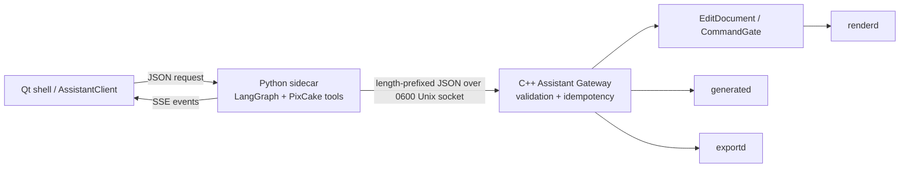

# PixCake 像素助手 Agent sidecar 规格

日期：2026-11-10
状态：已接入精修、快照、开发 fixture 异步生成与桌面确认；生产报价和打包待完成

## 判断

像素助手是 PixCake 的对话式任务编排入口。它负责把自然语言、多轮上下文和结构化卡片组织成 PixCake 能理解的任务；它不是图像处理引擎，也不是拥有文件系统和桌面控制权限的通用 Agent。

官方手册：[像素助手](https://www.pixcakeai.com/guide/233147)（更新于 2026-09-15）明确展示了任务清单、进度、实时画布、精细调整、效果快照、助手/专业模式切换、点数确认和停止后保留已完成结果等行为。这个行为决定了协议必须同时表达 `TaskPlan`、`EditPlan`、`CardRequest`、`SnapshotRef` 和流式事件，不能只返回一段模型文本。

## 运行拓扑



### 责任边界

| 层 | 允许做的事 | 明确禁止 |
| --- | --- | --- |
| Qt shell | 收集当前图片/选区引用，显示消息、卡片、进度和预览，启动/停止 sidecar | 直接提交编辑文档，解析模型私有参数 |
| Python sidecar | LangGraph 状态、自然语言理解、任务拆解、工具白名单、审批状态、SSE | 读取原图像素、写项目库/SQLite、访问 OpenGL、调用 Shell/桌面/MCP 工具 |
| Assistant Gateway | 校验协议、计划、修订号、确认门闩和幂等命令；把已验证请求交给主进程回调 | 拥有编辑文档、绕过 `CommandGate`、持久化会话正文 |
| 主进程/内核 | 编辑文档、历史、参数范围、渲染描述、生成任务、导出和点数账本 | 依赖 Python、LangChain、Qt 或 HTTP |

Python 的会话可以丢失，C++ 的编辑文档和历史不能丢失。助手模式和专业模式切换时，UI 重新读取 C++ 上下文即可继续同一线程。

## 协议和传输

### 外部 Agent 流

请求 schema 位于 [`agent/schema/assistant_request.schema.json`](../../../agent/schema/assistant_request.schema.json)，工具调用 schema 位于 [`agent/schema/assistant_tool_call.schema.json`](../../../agent/schema/assistant_tool_call.schema.json)，事件 schema 位于 [`agent/schema/assistant_events.schema.json`](../../../agent/schema/assistant_events.schema.json)。请求只包含：

- `request_id`、`thread_id` 和用户消息；
- 图片、编辑实例、选区和 `base_revision` 等引用；
- 偏好默认值，不包含凭证或像素。

事件包括增量消息、任务计划、编辑计划、结构化卡片、预览、审批、完成、取消和错误。SSE parser 可处理任意网络分块，单个事件上限 256 KiB。

### Sidecar 到 C++

开发环境可使用本机 HTTP 网关；发布模式优先使用 PixCake 创建的 0600 Unix socket。每个请求使用一条连接，帧格式为：

```text
u32 little-endian payload_length
payload_length bytes UTF-8 JSON
```

`payload_length` 最大 256 KiB。传输层只负责长度 framing，JSON 编解码由进程适配层完成，因此 `services/assistant` 不引入 Qt、HTTP、JSON 库或模型运行时。C++ `AssistantChannel` 和主进程 `QLocalServer` listener/JSON adapter 已实现，sidecar 由可选 `QProcess` 启停。

Qt 到 LangGraph 的请求使用标准 run envelope：`assistant_id`、`input.request` 和 `stream_mode=updates`；线程号放在 `/threads/{thread_id}/runs/stream` 路径中。这样 LangGraph 只保存对话/运行状态，编辑事实仍由 C++ 网关维护。

### 提交门闩

精修计划的正式提交必须满足：

1. 请求和计划的 `request_id` 相同；
2. 计划 `base_revision` 与当前请求相同；
3. 预览已经完成；
4. UI 给出明确确认；
5. C++ 回调通过现有命令入口提交。

提交命令由 `request_id + plan_id` 形成幂等键。重复请求返回第一次成功结果，不再次调用提交回调；旧修订号返回 `StateConflict`。
网关会保存最近一次成功预览的完整计划，提交时逐项比较操作和参数；只带有相同 `plan_id` 但没有对应预览，或提交内容被改写，都会返回 `StateConflict`。

生成任务独立使用 `task_id`、来源修订和费用确认，不复用 `EditPlan` 的预览键。开发 fixture 也必须经过桌面按钮确认，卡片明确标注测试生成及 0 点；真实供应商保持关闭至有效报价接入。模型传入 `user_confirmed=true` 不授予任何执行权限。快照应用复用已有历史记录与独立确认门闩。

### 桌面确认结果

四种正式操作（提交、撤销、快照应用、生成）在网关中保存完整请求，返回 `approval_id` 和 `pending`；该回复不是成功提交。只有可信桌面 `resolve_approval` 可批准保存的内容，JSON 路由没有批准命令。重复点击返回原决定，改写同一待执行键的参数会被拒绝；停止/切图使待确认操作失效。执行回调重新验证当前图片、编辑实例、修订；撤销还验证目标仍是最后一项助手编辑。

`get_approval_status` 是只读工具。`get_edit_context` 返回当前图片/编辑实例/线程的最近 16 项 `approval_history`，让下一轮能够取得 C++ 的真实结果。决策状态是 `pending/executing/approved/rejected/failed/expired`；生成批准后的 `queued` 与任务最终完成状态分别查询。

精修卡片从 C++ 保存的操作构建，参数正文按纯文本绘制，费用不采信模型给出的估算。拒绝时只恢复仍属于该助手请求的预览参数；已提交的文档和用户后来修改的值保持不变。当前参数 adapter 不解析语义选区，显式带 `target_selection_id` 的计划会被拒绝，避免把局部需求误写成全图调整。

## 工具白名单

第一版只暴露 PixCake 工具：上下文读取、任务清单、编辑计划预览/提交/拒绝、撤销、结构化卡片、生成任务、效果快照和快照应用。MM-AniPet 中的宠物人格、TTS、文件/Shell/桌面控制、网页、RAG、MCP 和通用多 Agent 模式均已删除或没有迁入。

后续新增工具必须同时更新三处：工具定义元数据、JSON schema/fixture 测试、C++ Gateway handler。工具不能因为被模型调用就获得额外权限。

## 已实现和未实现

已实现：

- 从 MM-AniPet 迁移并清理出独立 `agent/` 包；
- LangGraph 单图入口、PixCake 工具白名单、无模型 fixture、SSE parser；
- 版本化请求/计划/卡片/快照协议和 schema；
- C++ `AssistantGateway` 的验证、确认、修订匹配和幂等提交；
- C++ `AssistantChannel` 的本地 Unix framing；
- C++ SSE parser 和 Qt `AssistantClient` 的非阻塞流式传输、取消和可选 sidecar 启停；
- Qt 主进程的用户级 Unix listener/JSON adapter，以及按环境配置的 sidecar 启停；
- 精修页助手面板的对话行、事件状态、停止和隐藏入口；
- `get_edit_context` 返回 C++ registry 的能力描述和参数元数据（范围、步长、默认值、枚举、文本限制、禁用规则）；
- 一个能力的多参数预览/提交，复用现有 `PreviewSession`/`CommandGate`；
- C++ 网关记录成功预览的完整计划，提交前必须匹配该预览，避免绕过预览门闩；
- 快照创建和确认后的快照应用复用当前照片历史；快照引用只在当前编辑会话的图片上有效；
- `list_task_history` 只读现有生成会话历史，生成会话未接入时返回明确的不可用状态；
- `run_generation` 在确认和来源校验后返回 `task_id` / `queued`，后台执行现有生成会话。当前仅允许显式启用的开发 fixture；生产报价与费用确认尚未接入；
- `cancel_generation` 和助手停止操作请求合作式取消；任务已完成时保留终态。`queued` / `cancelling` 不是生成成功或取消完成的证明；
- 生成等待及结果文件校验在后台；主线程只接收已校验元数据，核对图片、编辑实例和修订号后提交图层。期间发生编辑/切图时不自动应用旧结果；
- 活跃任务读取不可变历史快照，终态读取生成历史；本次会话还返回 `succeeded-source-changed` 等应用状态，重启后以持久化的生成状态为准；
- Python fixture、Unix framing、协议和 C++ 领域网关测试。

下一阶段：

- 扩展参数卡片的展示与计划事件，并接入经过验证的语义选区 adapter；
- 为人像 AI、真实供应商报价/费用确认和导出增加 handler；
- 完成生产生成报价、导出和任务历史卡片的恢复流程，以及 sidecar 打包验收。

实现计划见 [`2026-11-10-pixcake-agent-sidecar.md`](../plans/2026-11-10-pixcake-agent-sidecar.md)。
